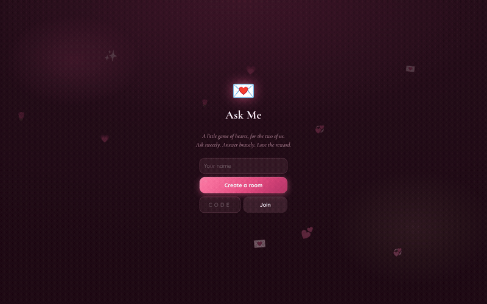
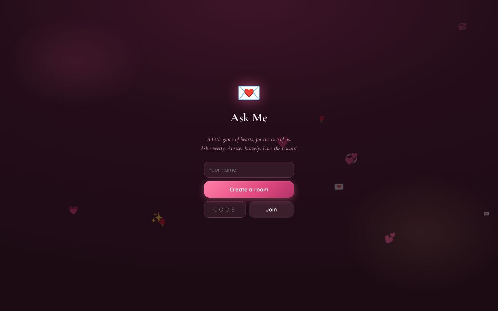
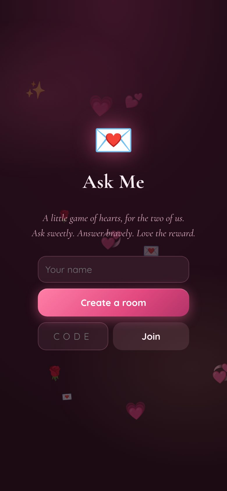

# Ask Me

> A little two-player game of hearts: create a room, share the code, ask sweetly, answer bravely and win IOUs.

**Live demo:** [ask-me-game.vercel.app](https://ask-me-game.vercel.app)

   

## Features

- Create a private room and share a short code; your partner joins from their own phone
- Real-time peer-to-peer play with PeerJS (no backend or accounts)
- Question rounds, rewards and a 'You won an IOU!' moment
- Floating-hearts animation, soft serif type, mobile-first layout

## Tech stack

- Single-file HTML with inline CSS and vanilla JavaScript
- PeerJS 1.5 (WebRTC) for the two-player connection
- Cormorant Garamond + Quicksand
- Hosted on Vercel

## Run it locally

```bash
git clone https://github.com/thedalycreative/ask-me-game.git
cd ask-me-game
npx serve .        # open in two browsers to play
```

## Deployment (Vercel)

Static site, repo root is the output. The Vercel project **ask-me-game** deploys `main` to **https://ask-me-game.vercel.app**. (Previously deployed by CLI as `ask-game`; source recovered from that deployment.)

## Screenshots



<p align="center">
  
  
</p>

_Captured from the live site (https://ask-me-game.vercel.app). Regenerate with any headless browser; files live in `docs/screenshots/`._

---

Built by [The Daly Creative](https://www.thedalycreative.com) · Perth, WA
